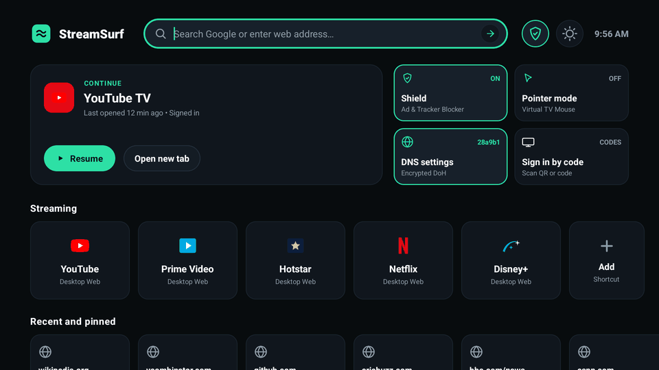
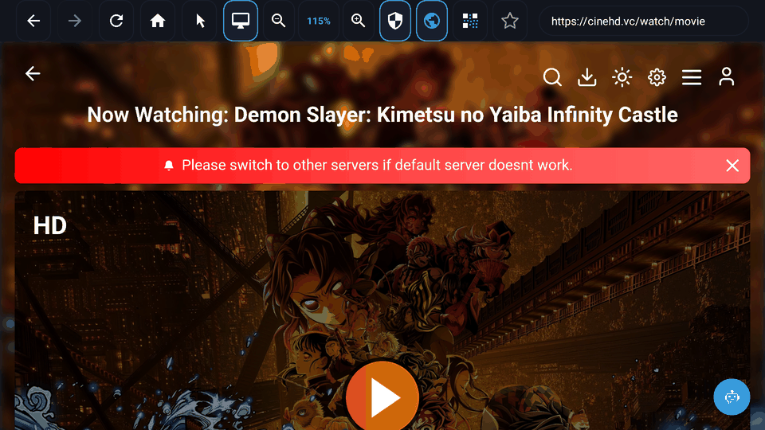

# StreamSurf TV

> Fast, private, remote-first web browser engineered from the ground up for Android TV and Google TV.

[](https://github.com/saikumargudelly/streamsurf_tv)
[](https://github.com/saikumargudelly/streamsurf_tv/releases/latest)
[](https://github.com/saikumargudelly/streamsurf_tv)
[](https://kotlinlang.org/)
[](LICENSE)
[](https://github.com/saikumargudelly/streamsurf_tv)

<p align="center">
  <a href="https://github.com/saikumargudelly/streamsurf_tv/releases/latest/download/streamsurf-tv-release.apk">
    
  </a>
  <br>
  <sub>Direct download • <b>streamsurf-tv-release.apk</b> (Signed production build)</sub>
</p>

---

## Overview

**StreamSurf TV** is an original web browser designed specifically for television hardware and remote controls. It pairs a clean 10-foot UI with a built-in content blocker, custom DNS-over-HTTPS (NextDNS), smart video streaming immunity, virtual pointer navigation, and crash-resilient memory management.

<p align="center">
  
  
</p>

---

## Key Features

- 🛡️ **StreamSurf Shield Ad-Blocker**: EasyList rule interception, cosmetic CSS element hiding, anti-popup/clickjack neutralization, and video ad skipping.
- 🌐 **Private DNS (NextDNS & DoH)**: Native DNS-over-HTTPS with custom NextDNS configuration ID and instant presets (Cloudflare, AdGuard, Quad9).
- 🎯 **Remote-First TV UX**: Smooth D-pad focus indicators, safe overscan margins, and a toggleable **Virtual Mouse Pointer Mode** for desktop websites.
- 🎬 **Zero-Stall Streaming Engine**: Smart media manifest and segment immunity (`.m3u8`, `.mpd`, `.ts`, `.m4s`, `.mp4`) preventing false-positive ad-blocking stalls.
- 📱 **Quick TV Sign-In**: Instant code sign-in launchpads for YouTube TV, Prime Video, Disney+ Begin, Hotstar QR, and Netflix TV.
- 🪶 **Low-RAM Architecture**: Single active WebView (< 130 MB host PSS) with compliant dead-process cleanup and rate-limited crash recovery.
- 🔒 **Zero Telemetry**: No trackers, analytics, or cloud backends. Authentication sessions persist locally with strict TLS enforcement.

---

## Remote Control Guide

| Key | Navigation Function |
|---|---|
| **D-Pad (Up / Down / Left / Right)** | Move focus across tiles, omnibar, and web links (or moves cursor in Pointer mode) |
| **OK / Center** | Click focused element, toggle fullscreen video, or click under virtual cursor |
| **BACK** | Close modals / Exit fullscreen video / Go back in history / Return to TV Home |
| **MENU / F2** | Jump focus directly to the top navigation toolbar |

---

## Sideloading onto Android TV

```bash
# 1. Connect to Android TV via ADB
adb connect <TV-IP-ADDRESS>:5555

# 2. Install the release APK
adb install -r streamsurf-tv-release.apk

# 3. Launch StreamSurf TV
adb shell am start -n dev.veyra.tv.browser/dev.veyra.tv.browser.ui.MainActivity
```

---

## Build from Source

```bash
# Clone the repository
git clone https://github.com/saikumargudelly/streamsurf_tv.git
cd streamsurf_tv

# Build signed release APK
./gradlew assembleRelease copyReleaseApkToDist
```
The compiled APK will be output to `dist/streamsurf-tv-release.apk`.

---

## License

Released under the [Apache License 2.0](LICENSE). Built purely with native AndroidX and Kotlin without proprietary tracking frameworks or third-party cloud SDKs.
